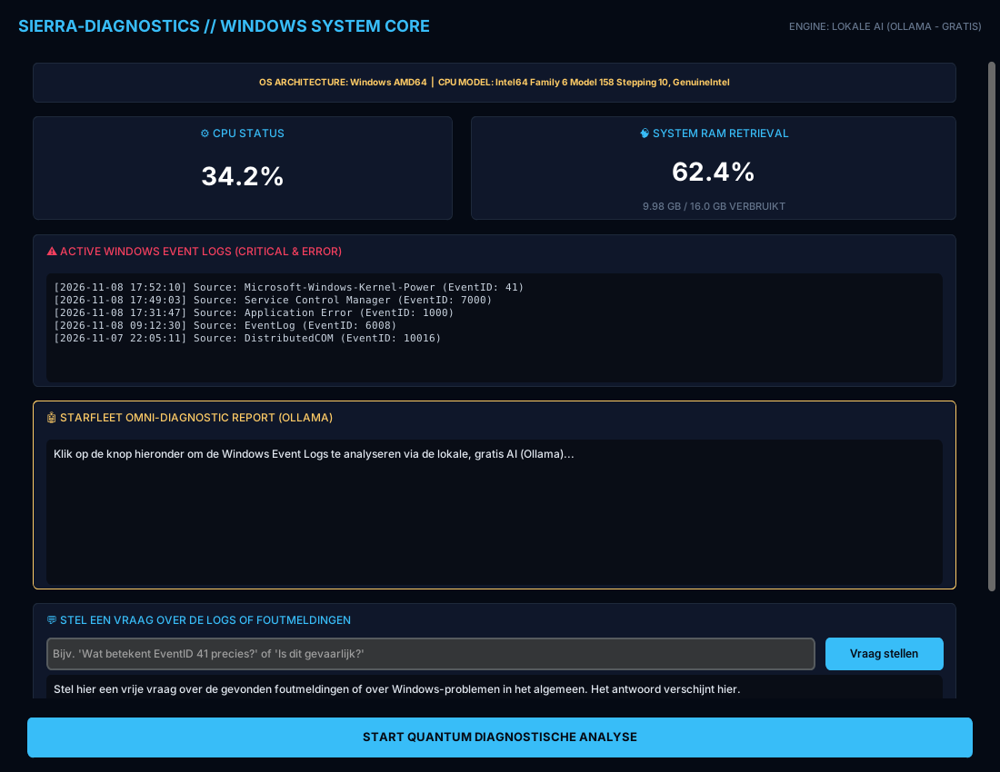
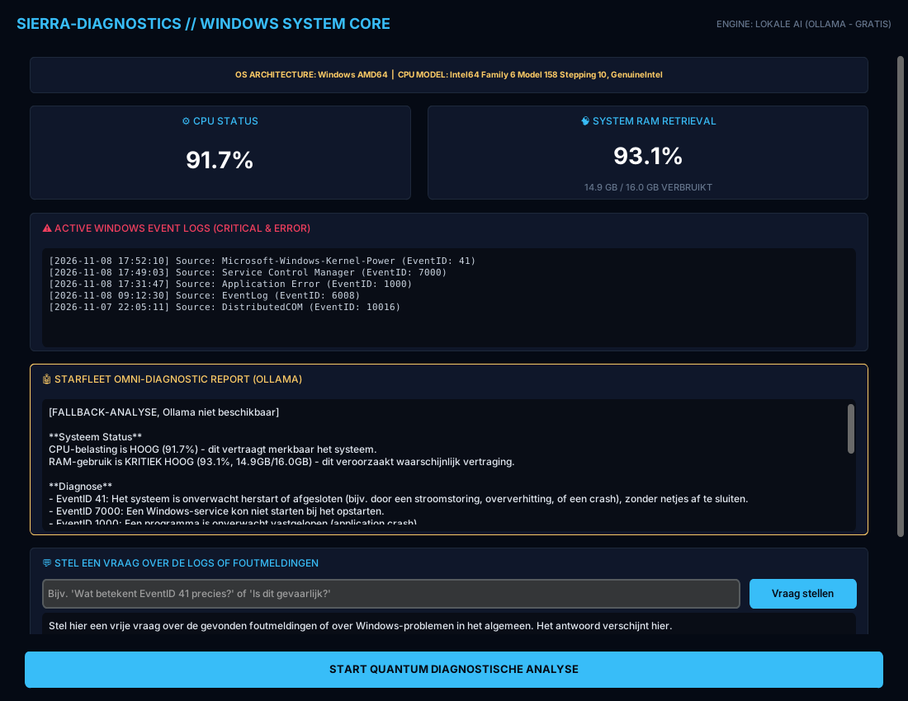
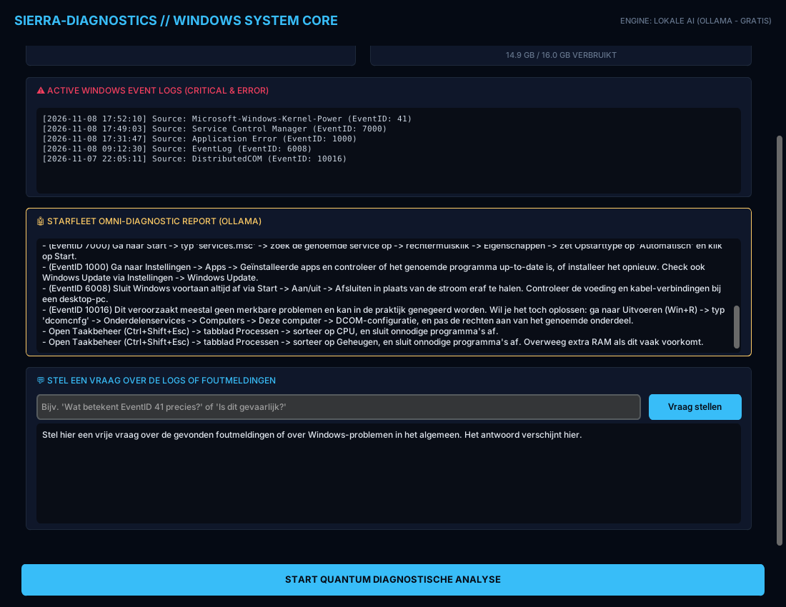
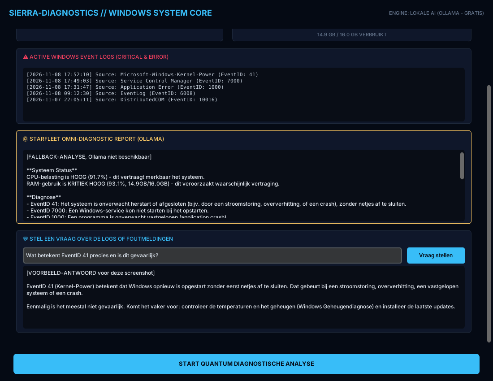
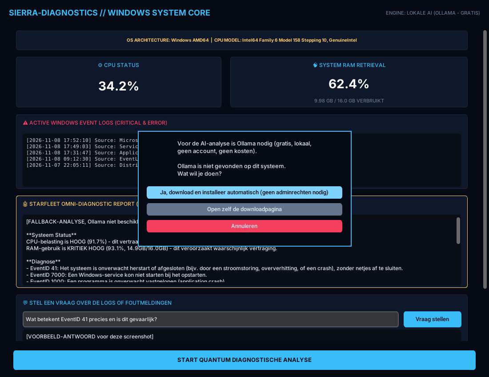
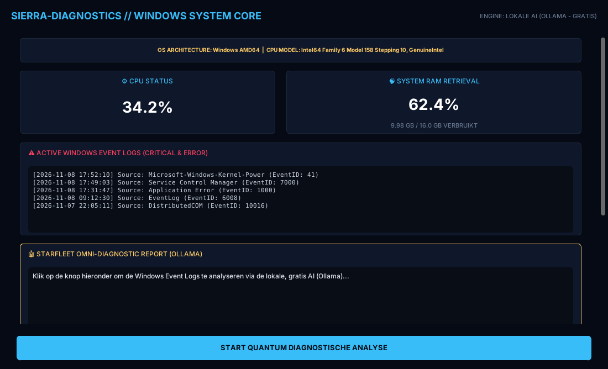
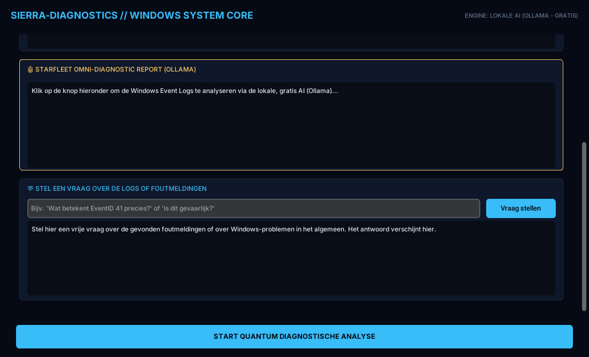

# Windows Diagnostic ("Sierra Diagnostics")

Een gratis Windows-programma met een Star Trek-uiterlijk dat de belasting van je pc en de
Windows-logboeken uitleest, de fouten analyseert en er een **stappenplan in gewoon Nederlands**
van maakt. Bedoeld voor mensen die geen computerexpert zijn: je krijgt geen cryptische foutcodes,
maar te horen *wat* er aan de hand is en *waar je in Windows moet klikken* om het op te lossen.

Geen account, geen API-sleutel, geen abonnement.



## Wat doet het?

- **Live CPU- en RAM-meter**, elke 2 seconden bijgewerkt.
- **Windows-logboek**: toont de laatste fouten uit het System Event Log (met bron en EventID).
- **Analyse met lokale AI** ([Ollama](https://ollama.com)): één klik op *START QUANTUM DIAGNOSTISCHE ANALYSE*
  levert een rapport met *Systeem Status*, *Diagnose* en *Stappenplan*. Alles draait op je eigen pc.
- **Ollama automatisch installeren**: staat Ollama nog niet op de pc, dan vraagt het programma
  toestemming om het te downloaden en te installeren (of opent de downloadpagina als je dat liever zelf doet).
- **Vraagveld**: typ een eigen vraag over een foutmelding en krijg een antwoord dat rekening houdt met
  wat er op jouw pc in de logs staat.
- **Werkt zonder AI**: lukt Ollama niet, dan valt het programma terug op een ingebouwde kennisbank
  met veelvoorkomende EventID's.
- **Past op elk scherm**: de inhoud is scrollbaar, en de analyseknop blijft altijd zichtbaar.

## Screenshots

> De screenshots zijn gemaakt met **demodata** (verzonnen CPU/RAM-waarden en voorbeeld-logregels) in een
> testomgeving, niet op een echte Windows-pc. Het antwoord in het vraagveld is een voorbeeldtekst, geen
> echte uitvoer van de AI. De lay-out en de knoppen zijn wel die van het echte programma.

### Analyse bij hoge belasting
Bij hoge CPU- en RAM-belasting en een paar foutmeldingen bouwt het programma een rapport op.
Dit voorbeeld is de ingebouwde fallback-analyse (zonder Ollama).



### Het stappenplan
Per gevonden EventID staat er een concrete actie, plus tips voor Taakbeheer als CPU of RAM te hoog is.



### Extra vragen stellen
Onderaan staat een vraagveld voor vragen over de foutmeldingen die je in de logboeken vindt.



### Ollama installeren, met toestemming
Is Ollama niet gevonden, dan verschijnt deze keuze. Er wordt niets gedownload voordat je klikt.



### Ook op een klein scherm
Op een laptop van 1366×768 past het venster zich aan en blijft de knop in beeld; de rest scrolt.

| Knop altijd zichtbaar | Scrollen naar het vraagveld |
|---|---|
|  |  |

## Installeren en starten

Vereist **Windows** en **Python 3.10+**.

```
pip install -r requirements.txt
python Diagnose.py
```

Op andere besturingssystemen start het programma ook, maar dan zijn alleen CPU en RAM beschikbaar:
de Windows-logboeken bestaan daar niet.

### Als .exe voor iemand anders

```
pip install pyinstaller
pyinstaller --onefile --windowed --collect-all customtkinter Diagnose.py
```

De `--collect-all customtkinter` is nodig: zonder die vlag mist de .exe de thema-bestanden van
customtkinter en start de app soms niet. Het resultaat staat in de map `dist/`.

## Ollama en het taalmodel

| | |
|---|---|
| Programma | Ollama, wordt zo nodig stil geïnstalleerd in je gebruikersprofiel (geen adminrechten) |
| Model | `llama3.2`, eenmalige download van ongeveer 2 GB |
| Kosten | geen |
| Internet | alleen nodig voor de eerste installatie en download; daarna draait de analyse lokaal |

Windows SmartScreen kan bij de eerste installatie een waarschuwing laten zien. De installer wordt
rechtstreeks van `ollama.com` gehaald.

## Hoe werkt het intern?

1. `psutil` leest CPU en RAM; `win32evtlog` leest de laatste 5 fouten (type *Error* en *Critical*) uit het System-log.
2. Bij een klik op de knop gaan die gegevens als context naar Ollama (`localhost:11434`), met de opdracht
   om in het Nederlands een Systeem Status, Diagnose en Stappenplan te schrijven.
3. Geeft Ollama geen bruikbaar antwoord, dan bouwt `bouw_lokaal_rapport()` zelf een rapport uit de
   kennisbank `EVENTID_KENNISBANK`. Voor een onbekende EventID wordt een korte uitleg opgezocht via de
   DuckDuckGo Instant Answer API, zonder sleutel. Alleen in dat geval gaat er een zoekterm als
   *"Windows Event ID 1234"* naar buiten.

### De kennisbank uitbreiden

De ingebouwde kennisbank dekt nu EventID's **41, 1000, 6008, 7000, 7001 en 10016**. Een nieuwe code
toevoegen is één blok bovenin `Diagnose.py`:

```python
"7036": {
    "diagnose": "Een service is gestart of gestopt.",
    "stappenplan": "Dit is normaal gedrag. Alleen bij herhaling: open services.msc en controleer de genoemde service."
},
```

## Goed om te weten

- De AI kan zich vergissen. Bekijk een voorgesteld stappenplan kritisch voordat je instellingen wijzigt,
  zeker bij dingen als services, DCOM-rechten of schijfcontrole.
- Het programma **wijzigt zelf niets** aan je systeem; het geeft alleen advies. De enige actie die het zelf
  uitvoert is de Ollama-installatie, en alleen nadat je daar op de knop voor hebt geklikt.
- Alleen de 5 meest recente fouten uit het System-log worden bekeken, niet de Application- of Security-logs.

## Bestanden

| Bestand | Inhoud |
|---|---|
| `Diagnose.py` | het hele programma |
| `requirements.txt` | benodigde Python-pakketten |
| `screenshots/` | afbeeldingen voor deze README |
